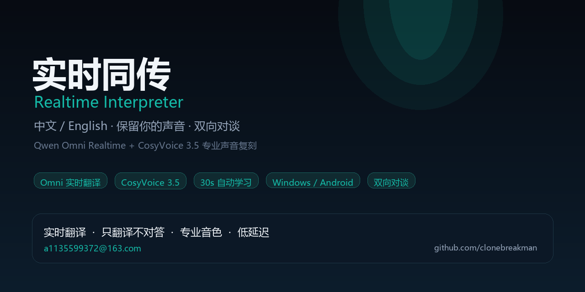
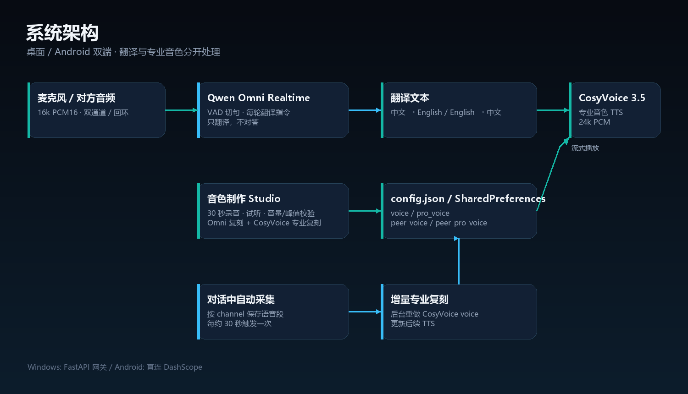
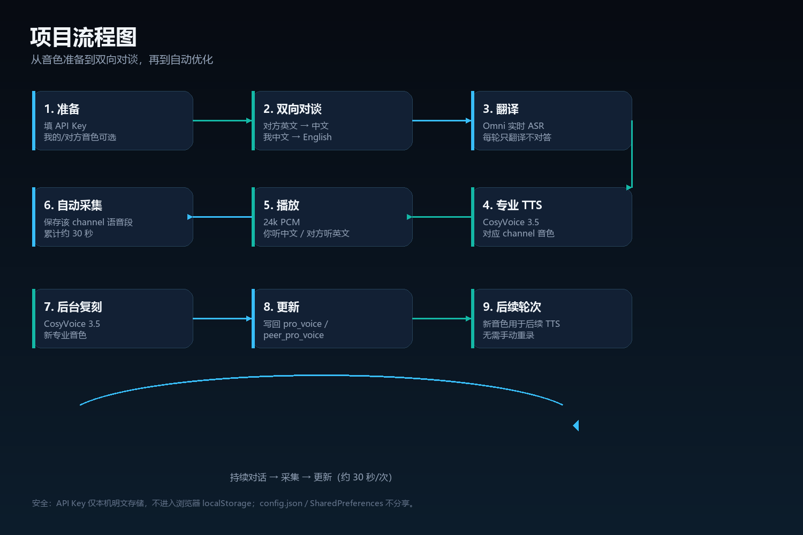

<p align="center">
  
</p>

<h1 align="center">实时同传 · Realtime Interpreter</h1>

<p align="center">
  中文 ⇄ English 实时语音翻译 · 保留你的声音 · 双向对谈
</p>

<p align="center">
  
  
  
  
  
  
</p>

> 一个可本地运行的实时语音翻译工具：**同传只翻译、不对答**；用 **Qwen Omni Realtime** 做实时识别与翻译，用 **CosyVoice 3.5** 做高相似度专业声音复刻；支持 **中文→英文**、**英文→中文**，以及桌面/Android 双向对谈。

## ✨ 功能

- **单向同传**：中文语音 → 英文文本 + 我的专业音色英文语音。
- **双向对谈**：对方英文 → 中文（对方音色）；我中文 → 英文（我的音色）。
- **只翻译，不对答**：每轮 `response.create` 携带“翻译引擎”指令，问题/命令只翻译，不执行。
- **专业声音复刻**：CosyVoice 3.5-plus，30 秒干净样本，音量归一化，高相似度。
- **30 秒采集 + 自动优化**：对谈中按通道保存语音段，累计约 30 秒自动重做专业音色，用于后续 TTS。
- **无初始录音也可用**：配置了默认音色时先用默认音色，边聊边自动学习；公开仓库默认留空，避免泄露个人音色 ID。
- **桌面 + Android**：Windows 免安装 exe；Android 原生 APK，含同传、音色制作、双通道对谈三个页面。
- **防回授**：Android 播放 TTS 时自动静音麦克风输入并加 900ms 保护期，并用 AcousticEchoCanceler，避免译文被再次识别造成重复翻译。
- **API Key 本地保存**：桌面 `config.json`，Android SharedPreferences；不写入浏览器 localStorage。

## 🖼 项目图

### 系统架构



Mermaid 源文件：[docs/architecture.mmd](docs/architecture.mmd)

### 项目流程图



Mermaid 源文件：[docs/flowchart.mmd](docs/flowchart.mmd)

> 项目图由项目内的 Python 绘图脚本 [scripts/make_github_assets.py](scripts/make_github_assets.py) 生成，流程图同时提供 Mermaid 源码，便于 GitHub 直接渲染和二次编辑。

## 🚀 快速开始

### Windows

```powershell
# 源码运行
python -m venv .venv
.\.venv\Scripts\pip install -e .
.\.venv\Scripts\python -m rti.server
```

或在本地运行 `scripts/build_desktop.py` 打包 `RTI.exe`（当前公开仓库不提交 37MB 二进制）。

1. 设置里填 `DASHSCOPE_API_KEY`；
2. 先到音色制作页录 30 秒“我的专业音色”（公开仓库不包含个人音色 ID；本地 config.json 填入 pro_voice 也可直接开始）；
3. 右上角 **⇄ 双向对谈** 进入双通道；
4. 音色制作页可录 30 秒，分别保存“我的音色 / 对方音色”。

### Android

**直接下载 APK（v1.3 / versionCode 4）**：

[RTI-android.apk](https://github.com/clonebreakman/realtime-interpreter/releases/download/v1.3/RTI-android.apk)

或本地构建：

```powershell
$env:JAVA_HOME='C:\Program Files\Microsoft\jdk-21.0.12.101-hotspot'
$env:ANDROID_HOME='C:\Android\sdk'
python android/build_apk.py
# 输出 dist/RTI-android.apk
```

APK 含：

- **同传**：中文 → 英文；
- **音色制作**：30 秒录音、试听、分析、保存；
- **双向对谈**：对方英文 → 中文 / 我中文 → 英文，两个输入设备可选。
- **防回授**：TTS 播放时暂停麦克风上传 + 900ms 保护期 + AEC。

## 🧱 项目结构

```text
src/rti/
  providers/omni.py       Qwen Omni Realtime WebSocket
  server/app.py            FastAPI 网关、配置、音色接口、自动采集
  voice/enroll.py         Omni 零样本复刻
  voice/professional.py   CosyVoice 3.5 专业复刻 + 流式 TTS
web/
  index.html / app.js     单向同传
  studio.html / studio.js 音色制作（30 秒）
  duo.html / duo.js       双向对谈
android/
  src/.../MainActivity.java        Android 同传
  src/.../VoiceStudioActivity.java 音色制作
  src/.../DuoActivity.java         双通道对谈
  build_apk.py                     aapt2/javac/d8/apksigner 构建
docs/
  assets/                 项目封面、架构图、流程图
  app-protocol.md         WebSocket / HTTP 协议
  flowchart.mmd            Mermaid 流程图
tests/                    53 个测试
```

## 🔐 安全说明

- `config.json` 和 Android SharedPreferences 中的 API Key、voice ID 为**本机明文**存储；
- `.gitignore` 已排除 `config.json`、profile 数据、录音、构建产物和 keystore；
- 不要把包含 Key 的配置文件、录音或手机分享给他人；
- 测试后建议轮换 API Key。

## 🧪 测试

```powershell
.\.venv\Scripts\python -m pytest
# 53 passed
```

## 🛠 常见问题

### Android 一直重复翻译

1. 确认安装的是 **v1.3 / versionCode 4** 或更新版本；
2. 播放 TTS 时 App 会临时丢弃麦克风帧（半双工）+ 900ms 保护期，并尝试开启系统 AEC；
3. 仍出现时优先用**耳机**，不要让手机扬声器的英文/中文回灌麦克风；
4. 抓日志：`adb logcat -s RTI AndroidRuntime`。

## 📬 联系

- 邮箱：**a1135599372@163.com**
- GitHub：[@clonebreakman](https://github.com/clonebreakman)

## 📄 更多文档

- [应用协议](docs/app-protocol.md)
- [完整技术说明](docs/README-full.md)
- [Qwen Omni 实测记录](docs/omni-measurements-2026-10-19.md)
- [同声传译调研报告](docs/2026-10-19-同声传译-调研报告.md)

---

<p align="center">如果这个项目对你有帮助，欢迎 Star ⭐</p>
